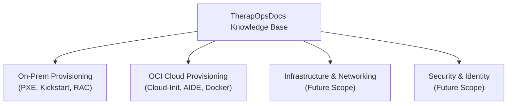

# TherapOpsDocs

Welcome to **TherapOpsDocs** — the enterprise operations knowledge base and standard operating procedures (SOP) repository for infrastructure, system administration, and workloads.

---

## 📚 Documentation Sections

### Active Modules

* **[On-Prem Provisioning & Lifecycle](provisioning/index.md)**: Standardized runbook for PXE boot, Kickstart installation, base hardening, network migration, and Oracle RAC storage setup.
* **[OCI Cloud Host Provisioning](oci-provisioning/index.md)**: Operational guide for Oracle Cloud Infrastructure (OCI) instances, including cloud-init verification, AIDE file integrity, volume extension, Docker CE versionlock, and system sanitization.

---

## 💡 Repository Principles

1. **Standardized Commands**: Only vetted, standard commands used by the operations team are documented.
2. **Modular Structure**: Topics are grouped logically under domain categories to support future expansion without cluttering top-level navigation.
3. **No Plaintext Secrets**: Sensitive keys, password hashes, and host-specific IPs are parameterized.
