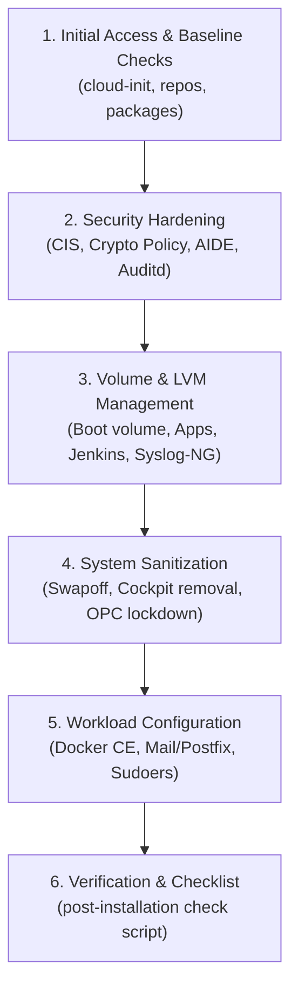

# OCI Cloud Host Post-Provisioning Guide

This section covers the standardized post-provisioning, hardening, volume management, and service configurations for Linux instances provisioned in **Oracle Cloud Infrastructure (OCI)**.

---

## 🗺️ OCI Provisioning Workflow

---

## 📑 OCI Guide Modules

| Module | Document | Description |
| :--- | :--- | :--- |
| **Stage 1** | [Initial Checks & Packages](initial-checks-packages.md) | Verify cloud-init output, repositories, and baseline packages. |
| **Stage 2** | [Security & Hardening](security-hardening.md) | OCI CIS script, Terrapin crypto policies, AIDE integrity, and auditd. |
| **Stage 3** | [Storage & LVM Management](storage-lvm.md) | Expanding root volume, configuring `/apps`, `/usr/local/jenkins`, and `/sftp`. |
| **Stage 4** | [System Sanitization & Access](system-sanitization.md) | Disabling swap, removing Cockpit, disabling OPC user & root login. |
| **Stage 5** | [Workloads & Services](workloads-services.md) | Docker CE installation with versionlock, Postfix mail check, Syslog-NG. |
| **Stage 6** | [Verification Checklist](verification-checklist.md) | Post-installation check script and signoff validation. |
