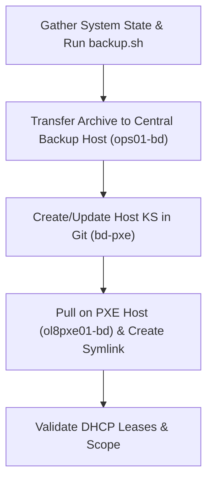

# 1. Pre-Provisioning Phase

Before any operating system re-installation or hardware provisioning begins, two critical requirements must be met:

1. **Backup Existing Configuration**: Ensuring all networking, routing, mount points, and application files from the existing server are archived remotely.
2. **PXE / Kickstart Staging**: Preparing and publishing the kickstart (`.cfg`) file on the central PXE server.

---

### Step-by-Step Flow

---

### Phase Guides

* [Host Backup Runbook](backup-runbook.md) — Comprehensive commands & scripts to capture system baseline.
* [PXE & DHCP Setup](pxe-dhcp-setup.md) — Kickstart git workflow, web hosting permissions, and DHCP range check.
