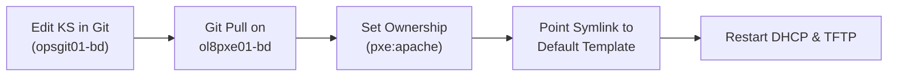

# PXE & DHCP Staging

All host provisioning in our environment is managed through central PXE boot and automated Kickstart files served from `ol8pxe01-bd.therapbd.net`.

---

## 1. Kickstart (KS) Staging Workflow



### Step 1: Commit KS in Git
* **Repository**: `https://opsgit01-bd.therapbd.net/bd-pxe/ol8pxe01-bd`
* **Path**: `KS/<HOSTNAME>.cfg` (e.g. `OL8-bdrac32.cfg`)
* Commit changes and submit for peer review.

### Step 2: Pull Changes on PXE Host
Log in to `ol8pxe01-bd.therapbd.net` as the `pxe` user:
```bash
cd /usr/local/BD-PXE
git pull
```

### Step 3: Apply Permissions & Set Symlink
Switch to `root` user to update web permissions and symlink the generic minimal template to your host configuration:
```bash
cd /usr/local/BD-PXE/ol8pxe01-bd/KS

# Ensure proper group permissions for Apache
chown -R pxe:apache <HOSTNAME>.cfg
chmod 644 <HOSTNAME>.cfg

# Symlink to default PXE request endpoint
ln -fs <HOSTNAME>.cfg oracle-linux-8.10-minimal-ks.cfg
```

---

## 2. DHCP Configuration & Verification

DHCP server config is located at `/etc/dhcp/dhcpd.conf`.

### Dedicated PXE IP Scope
Ten (10) temporary IP addresses are allocated on the management LAN for PXE provisioning:
```text
192.168.48.241 - 192.168.48.250
```

### DHCP Subnet Definition Reference
```text
subnet 192.168.48.0 netmask 255.255.255.0 {  
  option domain-name-servers 192.168.51.54, 192.168.54.54;  
  option broadcast-address 192.168.48.255;  
  option routers 192.168.48.2;  
  default-lease-time 14400;  
  max-lease-time 28800;  
  
  if substring(vendorclass, 0, 9) = "PXEClient" {  
    if pxetype = 00:06 or pxetype = 00:07 {  
      filename "efi/shim.efi";        # UEFI bootloader
    } else {  
      filename "pxelinux.0";          # Legacy BIOS bootloader
    }  
  }  
  pool {  
    range 192.168.48.241 192.168.48.250;  
  }  
  next-server 192.168.48.239;         # ol8pxe01-bd IP
}
```

### Step 4: Clear Leases and Restart Services
Before rebooting the target machine into PXE boot, refresh DHCP and TFTP:
```bash
# Clear stale leases if required
echo "" > /var/lib/dhcpd/dhcpd.leases

# Restart services
systemctl restart dhcpd
systemctl restart tftp

# Verify service health
systemctl status httpd dhcpd tftp.service --no-pager
```

!!! tip "DHCP Lease Check"
    To monitor target host lease acquisition in real time:
    ```bash
    tail -f /var/lib/dhcpd/dhcpd.leases
    ```
