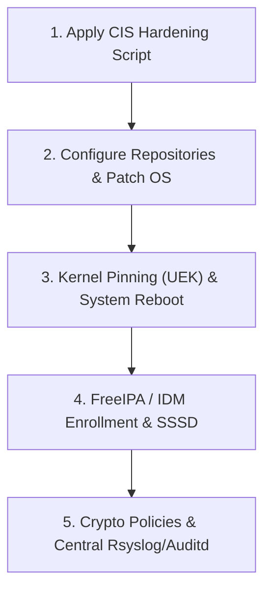

# 3. Base OS Post-Installation & Hardening

Once the minimal OS is deployed via Kickstart, complete the standard base configuration before configuring workload-specific services or switching production networks.

---

### Sequence of Post-Install Steps

---

### In this Section

* [CIS Benchmark Hardening](cis-hardening.md) — Fetching, executing, and auditing the security benchmark script.
* [Repositories & Kernel Configuration](repos-kernel.md) — UEK repo control, kernel version pinning, and OS patching.
* [FreeIPA / IDM & SSSD](idm-sssd.md) — Central authentication join and Nagios monitoring setup.
* [Security, Auditd & Syslog](security-syslog.md) — Crypto policies (`NOSHA1`, `NOCBC`), `rootsh`, and auditd logging.
