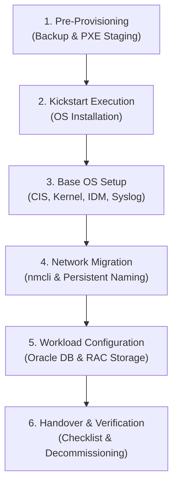

# Host Provisioning & Lifecycle Guide

This section contains the end-to-end operational guide for provisioning, configuring, hardening, and verifying enterprise Linux systems (Oracle Linux 8) across Application, Database, and Oracle RAC nodes.

---

## 🗺️ Provisioning Lifecycle Overview

---

## 📑 Provisioning Stages

| Stage | Section | Description |
| :--- | :--- | :--- |
| **Stage 1** | [Pre-Provisioning](01-pre-provisioning/index.md) | Backup procedures and PXE/DHCP staging. |
| **Stage 2** | [OS Provisioning](02-provisioning/kickstart-execution.md) | Kickstart installation and validation. |
| **Stage 3** | [Base OS & Hardening](03-post-install-base/index.md) | CIS hardening, kernel management, IDM enrollment, and syslog. |
| **Stage 4** | [Network Migration](04-network-migration/index.md) | App & DB network configuration, interface renaming. |
| **Stage 5** | [Workload & Storage](05-workload-specific/oracle-prereqs.md) | Oracle database prerequisites and NetApp iSCSI/multipath. |
| **Stage 6** | [Verification & Handover](06-verification-handover/checklist.md) | Final verification checklist and old host decommissioning. |
